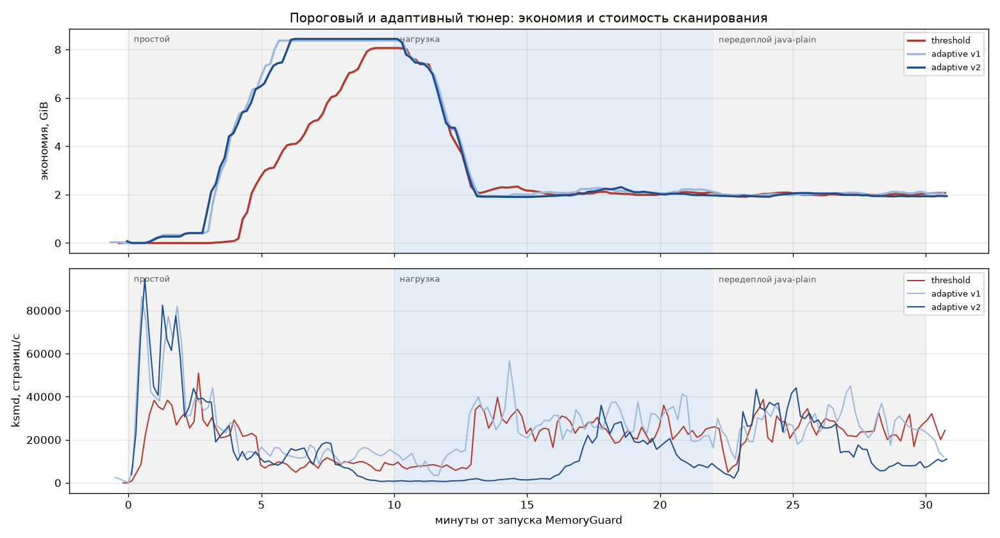

# MemoryGuard

Агент для Linux-хостов с Docker. Включает дедупликацию памяти ядра (KSM) для контейнеров, сам решает, как часто ksmd сканировать память, и не даёт сливать страницы тех сервисов, которым нельзя доверять друг другу.

Идея старая. В конце 90-х в Стэнфорде делали гипервизор Disco и заметили, что виртуалки на одной машине держат в памяти кучу одинаковых страниц. Их можно хранить в одном экземпляре и копировать только при записи. В Linux это давно есть и называется KSM. Но ядро сливает только ту память, которую процесс сам пометил через `madvise(MADV_MERGEABLE)`, а обычные сервисы в контейнерах этого не делают. Я написал агент, который помечает память за них.

Потом я построил стенд и померил, сколько это даёт на самом деле. Получилось меньше, чем я рассчитывал. Цифры ниже, подробности в отчётах.

## Результаты

Стенд: 30 контейнеров (Java 21, Python, Node, Redis), занято 22 из 25 GiB, около 2 300 запросов в секунду. Ядро 6.18 под WSL2.

| | Простой | Под нагрузкой |
|---|---|---|
| Сэкономлено RAM | 8.1 GiB, 35% памяти хоста | 1.7–2.1 GiB, около 8% |
| Латентность p50 / p99 | | +1% / +3% (около 1 мс) |
| CPU на ksmd | | около 0.15 ядра из 18 |

Почти вся экономия, 97–99%, получается на нулевых страницах. Это JVM с `-XX:+AlwaysPreTouch`, которые заранее занимают весь heap нулями. Я ждал, что реплики одного сервиса с побайтно одинаковыми данными будут хорошо сливаться между собой. Они не сливаются: на 26 репликах набралось около 65 MiB. В объектах Java, Python и V8 лежат указатели, заголовки и счётчики, уникальные для каждого процесса, поэтому одинаковые данные не дают одинаковых страниц.

Под нагрузкой G1 пишет по всему heap, и экономия на нулях уходит за две с половиной минуты: с 8.2 до 2.2 GiB.

Так что MemoryGuard имеет смысл там, где много JVM простаивает: CI-раннеры, стенды разработчиков, staging. На нагруженном проде выигрыш около 8%, и тут уже надо считать, стоит ли оно того.

## Адаптивный тюнер

Первая версия меняла скорость сканирования по порогам свободной памяти. Вторая смотрит на результат: если за последние пару минут сканирование не дало новых слитых страниц, ksmd замедляется. Пришлось считать эффективность по окну и двумя метриками. Под нагрузкой KSM всё время сливает одни страницы, а приложение ломает другие. Если смотреть только на приросты, тюнер гонял бы ksmd на полной скорости вечно, хотя общий уровень экономии стоит на месте.

Один и тот же сценарий (простой, потом нагрузка, потом передеплой), старый тюнер против нового:

| | по порогам | адаптивный |
|---|---|---|
| Экономия за цикл, GiB·мин | 85 | 104 (+23%) |
| Просканировано страниц, млн | 39 | 30 (−22%) |
| Время до 90% пика в простое, мин | 8.8 | 5.9 |
| p99 под нагрузкой, мс | 37.6 | 37.1 |

Цена есть: в простое новый тюнер тратит больше CPU, потому что быстрее сходится (2.9% против 1.8% всех ядер).



## Безопасность

KSM известен атаками по времени. Если запись в страницу идёт медленно, значит, она общая, и у соседа по хосту есть такая же. Так можно узнать, какая библиотека или какие данные лежат в чужом процессе. Поэтому агент по умолчанию ничего не трогает:

- сливается только память контейнеров из белого списка, исключения всегда важнее;
- базы и хранилища (Redis, Postgres, MySQL, Mongo, Vault, etcd и т.п.) не сливаются, даже если попали в список, пока их не разрешить явно;
- регионы с ключами (mlock, `MADV_DONTDUMP`, `.bss` криптобиблиотек) инжектор пропускает;
- `max_page_sharing=2` против CVE-2024-0564. Я сравнил 2 и 16 дважды, экономия одинаковая, так что на этой нагрузке защита ничего не стоит;
- детектор аномалий останавливает ksmd, если картина слияний выглядит подозрительно;
- контейнер запускается без `--privileged`, только с `SYS_PTRACE` и `pid: host`. Дашборд слушает localhost, а управление требует токен.

Разбор угроз: [KSM_THREATS.md](memoryguard/doc/KSM_THREATS.md), [SECURITY.md](memoryguard/doc/SECURITY.md).

## Что пошло не так

Первые два прогона я остановил. Нашлось три бага: Redis всё-таки сливался в обход запрета, а детектор дважды сработал ложно и заморозил ksmd больше чем на 10 минут. В третьем прогоне параллельно крутился забытый процесс сценария от второго, и данные пришлось переразмечать по логам ([relabel_run3.py](Исследования/Эксперимент_3_нагрузка/relabel_run3.py)). Всё исправлено и перепроверено, история есть в отчёте.

[implementation_plan.md](implementation_plan.md) я оставил как был. Это план сливать память только между репликами одного образа, и эксперимент его не подтвердил.

## Как устроено

Агент написан на Java 21 и собирается в GraalVM native image, около 35 MB. Список контейнеров берётся из Docker API, ksmd управляется через `/sys/kernel/mm/ksm`. Помечает память небольшой инжектор на C: подключается к процессу через ptrace, проверяет, что PID всё ещё принадлежит нужному контейнеру, и вызывает в нём `madvise`. Раз в 10 минут проходит ещё раз и помечает то, что выросло. На порту 8787 есть дашборд и REST API.

Подробнее: [архитектура](memoryguard/doc/ARCHITECTURE.md), [API](memoryguard/doc/API.md), [компоненты](memoryguard/doc/COMPONENTS.md).

## Запуск

```bash
export MEMORYGUARD_CONTAINER_WHITELIST="my-service-*"
export MEMORYGUARD_API_TOKEN=$(openssl rand -hex 32)
docker compose up -d --build
```

Дашборд откроется на http://localhost:8787. Все переменные описаны в [docker-compose.yml](docker-compose.yml) и [DEPLOYMENT.md](memoryguard/doc/DEPLOYMENT.md). Нужно ядро с KSM, для `smart_scan` 6.7 или новее.

## Где что лежит

- `memoryguard/` — код агента и документация
- `Исследования/Эксперимент_3_нагрузка/` — стенд, генератор нагрузки, сырые метрики всех прогонов, графики и два отчёта: [основной](Исследования/Эксперимент_3_нагрузка/Отчёт.md) и [про адаптивный тюнер](Исследования/Эксперимент_3_нагрузка/Отчёт_2_адаптивный_тюнер.md)

## Ограничения

Я гонял всё под WSL2 на одной машине, на железном сервере и на NUMA пока не проверял. Нагрузка синтетическая, хоть и похожая на настоящие сервисы. Инжекция через ptrace на короткое время останавливает процесс, на большом количестве контейнеров это надо учитывать.

---

**In short (EN).** MemoryGuard turns on Linux KSM for Docker containers by injecting `madvise(MADV_MERGEABLE)` via ptrace, tunes the ksmd scan rate with a feedback loop, and refuses to merge untrusted or data-store containers. On a 30-container test bed it saved 8.1 GiB (35%) idle but only ~2 GiB (8%) under 2.3k RPS, almost all of it from zeroed JVM pages; identical application data does not produce identical pages. The adaptive tuner saved 23% more memory over a full cycle with 22% less scanning. Full reports with raw data are in `Исследования/` (Russian).
