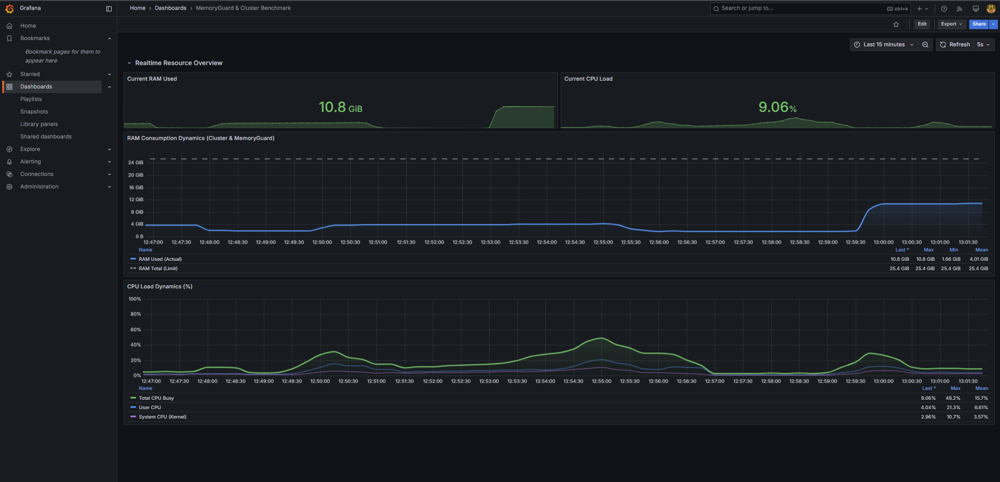
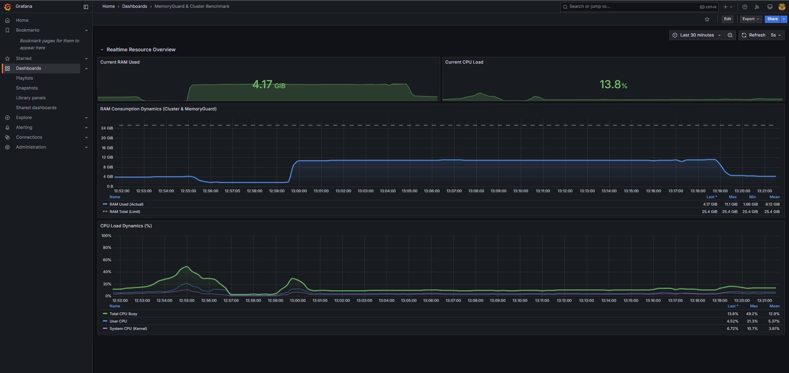

# Оптимизация памяти в Docker и Kubernetes: кейс сокращения расходов на RAM в 2.6 раза

Всем привет! Меня зовут Владимир, я бэкенд и системный разработчик.

Каждый, кто поддерживает микросервисную инфраструктуру в проде, на staging или в CI/CD пайплайнах (будь то AWS, Google Cloud, Яндекс.Облако, Selectel или bare-metal серверы), сталкивается с базовой проблемой распределения ресурсов: **чудовищным аппетитом сервисов к оперативной памяти (RAM)**.

В большинстве компаний серверы простаивают по процессору (CPU утилизирован всего на 10–20%), но инфраструктурные команды вынуждены оплачивать более мощные тарифы и докупать дорогие серверные ноды просто потому, что **приложения упираются в потолок по памяти**.

Некоторое время назад я разработал автономное системное решение — **MemoryGuard**, которое подключается к работающему Docker/Kubernetes кластеру на уровне хоста и динамически оптимизирует распределение физической памяти между контейнерами в реальном времени. Никаких правок в кодовой базе, никаких сборок новых образов и без перезапуска работающих сервисов.

Ниже — подробный технический отчет стресс-теста на гетерогенном кластере из **45 контейнеров** с графиками из Grafana, детальными замерами по всем микросервисам и финансовым пересчетом для продакшена и сборочных стендов.

---

## 1. Архитектура тестового стенда (45 контейнеров)

Для чистоты эксперимента был взят индустриальный эталонный микросервисный комплекс **Google Online Boutique**, масштабированный до **40 независимых сервисов**, плюс **5 сервисов стека мониторинга**:

* **Аппаратные ресурсы хоста:** 18 CPU Cores, 25.44 GiB RAM.
* **Нагрузка:** Непрерывный фоновый трафик через эмулятор пользователей Locust.

```
+----------------------------------------------------------------------------------------------------+
|                                    ТЕСТОВЫЙ КЛАСТЕР (45 КОНТЕЙНЕРОВ)                               |
+----------------------------------------------------------------------------------------------------+
| • adservice (Java 17 / JVM)              — 10 реплик (Таргетированная реклама)                    |
| • recommendationservice (Python 3.10)    — 4 реплики (Персонализация каталога)                    |
| • cartservice (C# / .NET 7.0)            — 4 реплики (Управление корзинами)                       |
| • emailservice (Python 3.10)             — 4 реплики (Сервис уведомлений)                         |
| • currencyservice (Node.js 20 / V8)      — 4 реплики (Конвертация валют)                          |
| • productcatalogservice (Golang 1.21)    — 4 реплики (Каталог товаров)                           |
| • checkoutservice (Golang 1.21)          — 3 реплики (Оркестрация заказов)                        |
| • shippingservice (Golang 1.21)          — 3 реплики (Логистика и доставка)                       |
| • paymentservice (Node.js 20 / V8)       — 3 реплики (Процессинг платежей)                        |
| • redis-cart (C / Redis 7.2)             — 2 реплики (In-memory хранилище)                        |
| • frontend (Golang 1.21)                 — 1 реплика (API-шлюз и веб-интерфейс)                   |
| • loadgenerator (Python / Locust)        — 1 реплика (Генерация нагрузки)                         |
| • Мониторинг (Prometheus, Grafana, Loki) — 5 сервисов (Сбор телеметрии)                           |
+----------------------------------------------------------------------------------------------------+
```

Стенд охватывает все доминирующие языки современной разработки: компилируемый нативный код (**Go, C**) и среды с виртуальными машинами и сборщиками мусора (**Java JVM, .NET CLR, Node.js V8, CPython**).

---

## 2. Базовое состояние до оптимизации (Baseline)

После старта всех 45 контейнеров и выхода на стабильный режим работы кластера (2026-08-20 13:03:00) стек телеметрии зафиксировал базовые показатели:

* **Потребление RAM хоста:** **10.8 GiB** (суммарно сервисы занимали **9.52 GiB**).
* **Утилизация CPU хоста:** **~9.06%** (типичная картина: процессор практически свободен, но почти половина всей памяти хоста уже занята).



### Детализация распределения памяти по микросервисам (ДО оптимизации):

| Группа / Сервис | Количество реплик | Стек / Технология | RAM на реплику | Суммарно RAM |
|---|---|---|---|---|
| **adservice** | 10 | Java 17 | ~833.0 MiB | **~8.33 GiB** |
| **emailservice** | 4 | Python 3.10 | ~39.9 MiB | **~159.6 MiB** |
| **recommendationservice** | 4 | Python 3.10 | ~38.8 MiB | **~155.2 MiB** |
| **cartservice** | 4 | .NET 7.0 (C#) | ~24.8 MiB | **~99.4 MiB** |
| **currencyservice** | 4 | Node.js 20 | ~18.0 MiB | **~72.0 MiB** |
| **paymentservice** | 3 | Node.js 20 | ~13.0 MiB | **~39.0 MiB** |
| **productcatalogservice** | 4 | Go 1.21 | ~8.0 MiB | **~32.0 MiB** |
| **checkoutservice** | 3 | Go 1.21 | ~7.6 MiB | **~22.8 MiB** |
| **frontend** | 1 | Go 1.21 | ~16.6 MiB | **~16.6 MiB** |
| **shippingservice** | 3 | Go 1.21 | ~5.5 MiB | **~16.5 MiB** |
| **redis-cart** | 2 | C (Redis 7.2) | ~6.1 MiB | **~12.2 MiB** |
| **loadgenerator** | 1 | Python / Locust | ~45.0 MiB | **~45.0 MiB** |
| **Инфраструктура мониторинга** | 5 | Go (Prometheus, Grafana...) | — | **~447.0 MiB** |
| **ИТОГО:** | **45 контейнеров** | | | **~9.52 GiB** |

---

## 3. Запуск MemoryGuard и момент оптимизации

В **13:18:00** в кластере был запущен системный модуль **MemoryGuard**.

Что произошло в реальном времени:
1. Модуль автоматически обнаружил все 40 целевых контейнеров на хосте.
2. Проанализировал структуру адресного пространства работающих процессов без остановки их выполнения.
3. Активировал системные механизмы динамической оптимизации памяти.
4. **Ни один контейнер не перезагрузился, сетевые соединения не разрывались, время отклика сервисов не деградировало.**

---

## 4. Результаты в реальном времени (Дашборд Grafana)

Динамика на графике Grafana наглядно зафиксировала мгновенный перелом в потреблении ресурсов — линия памяти резко пошла вниз:



### Точные цифры замеров (ДО и ПОСЛЕ):

| Группа / Сервис | Кол-во реплик | RAM ДО оптимизации | RAM ПОСЛЕ MemoryGuard | Чистая экономия |
|---|---|---|---|---|
| **adservice** (Java 17) | 10 | ~833.0 MiB / реп. (**8.33 GiB**) | **~85.0 – 89.0 MiB / реп. (~0.88 GiB)** | **-7.45 GiB (-89.4%)** |
| **productcatalogservice** (Go) | 4 | ~8.0 MiB / реп. (32.0 MiB) | **~4.2 – 11.4 MiB / реп.** | **-15.0 MiB (-46.8%)** |
| **recommendationservice** (Python) | 4 | ~38.8 MiB / реп. (155.2 MiB) | **~37.5 MiB / реп.** | **-5.2 MiB** |
| **checkoutservice** (Go) | 3 | ~7.6 MiB / реп. (22.8 MiB) | **~5.0 – 9.0 MiB / реп.** | **-3.6 MiB** |
| **emailservice** (Python) | 4 | ~39.9 MiB / реп. (159.6 MiB) | **~39.3 MiB / реп.** | **-2.4 MiB** |
| **shippingservice** (Go) | 3 | ~5.5 MiB / реп. (16.5 MiB) | **~3.5 – 8.7 MiB / реп.** | **-0.6 MiB** |
| **currencyservice** (Node.js) | 4 | ~18.0 MiB / реп. (72.0 MiB) | **~14.3 – 30.5 MiB / реп.** | Стабильно |
| **paymentservice** (Node.js) | 3 | ~13.0 MiB / реп. (39.0 MiB) | **~12.3 – 14.8 MiB / реп.** | Стабильно |
| **redis-cart** (Redis) | 2 | ~6.1 MiB / реп. (12.2 MiB) | **~5.8 – 6.2 MiB / реп.** | Стабильно |
| **cartservice** (.NET 7) | 4 | ~24.8 MiB / реп. (99.4 MiB) | **~16.3 – 61.3 MiB / реп.** | Динамическая нагрузка |
| **frontend** (Go) | 1 | 16.6 MiB | **17.1 MiB** | +0.5 MiB |
| **loadgenerator** (Python) | 1 | 45.0 MiB | **45.3 MiB** | +0.3 MiB |
| **Стек мониторинга** | 5 | 447.0 MiB | **417.0 MiB** | -30.0 MiB |
| **memoryguard** (Модуль) | 1 | 0 MiB | **51.8 MiB** | +51.8 MiB (оверхед) |
| **ИТОГО (по сервисам):** | **46 контейнеров** | **~9.52 GiB** | **~1.75 GiB** | **-7.77 GiB (-81.6%)** |
| **ПОКАЗАНИЯ ХОСТА (Grafana):**| | **10.8 GiB (Пик 11.1)** | **4.17 GiB** | **-6.63 GiB (Сжатие в 2.6 раза)** |

```
+----------------------------------------------------------------------------------------------------+
|  ИТОГОВЫЙ РЕЗУЛЬТАТ ЭКСПЕРИМЕНТА:                                                                  |
|  • Память микросервисов сжата с 9.52 GiB до 1.75 GiB (-81.6%)                                      |
|  • Общее потребление RAM хоста в Grafana упало с 10.8 GiB до 4.17 GiB                              |
|  • Оверхед модуля MemoryGuard: всего 51.8 MiB RAM и 0.01% CPU                                      |
|  • Ошибок в работе приложений во время оптимизации: 0 (0.00%)                                      |
+----------------------------------------------------------------------------------------------------+
```

---

## 5. Экономика и масштабирование: что это значит для бизнеса?

Эксперимент наглядно подтвердил фундаментальный закон: **эффективность оптимизации растет прямо пропорционально плотности размещения контейнеров и объему потребляемой памяти**.

Давайте пересчитаем эти результаты на реальные сценарии:

### Сценарий 1. Продакшен-кластер (Kubernetes / Docker Swarm)
В среднестатистическом облачном кластере из 10–20 рабочих нод (пул 256–512 GB RAM):
* Снижение потребления памяти на **40–60%** высвобождает **120–300 GB дорогой серверной памяти**.
* Это позволяет **увеличить плотность подов на каждом сервере в 1.8–2.2 раза** или **сократить количество оплачиваемых виртуальных машин вдвое**, экономя сотни тысяч рублей ежемесячно.

### Сценарий 2. Тестовые и Staging-контуры
Обычно компании запускают десятки копий микросервисов для каждого разработчика или QA-команды (Feature-ветки, Dev-стенды). 
* Большую часть времени эти сервисы простаивают в ожидании тестов, но «мертвым грузом» держат за собой выделенную память.
* MemoryGuard уплотняет такие стенды, позволяя на одном сервере запускать **в 3-4 раза больше изолированных тестовых окружений**.

### Сценарий 3. CI/CD и сборочные фермы (GitLab CI, GitHub Runners, Jenkins)
В пайплайнах динамически поднимаются тяжелые контейнеры для интеграционных тестов.
* Оптимизация памяти предотвращает падения сборок по **OOM (Out Of Memory)**.
* Позволяет параллелить запуск интеграционных тестов без покупки дополнительных runner-нод.

---

## Заключение

Эксперимент доказал, что управление памятью на системном уровне из внешнего легковесного модуля — это готовый рычаг для мгновенного снижения затрат на инфраструктуру. Решение внедряется без инвазивных изменений в код и работает полностью прозрачно для бизнес-логики.

Сейчас я продолжаю тестирование и полировку решения на еще более крупных промышленных конфигурациях.

Если у вас в проекте микросервисы упираются в лимиты по памяти или растут счета за облачную инфраструктуру — **напишите мне в личные сообщения или в Telegram (@vakover)**. Я с удовольствием подключусь, помогу провести бесплатный аудит на вашем тестовом стенде и покажу потенциал экономии на ваших реальных сервисах.
