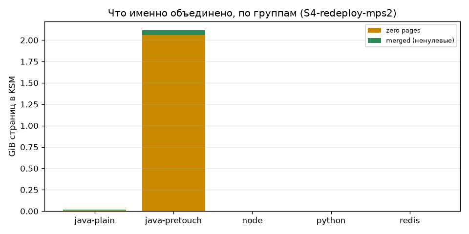
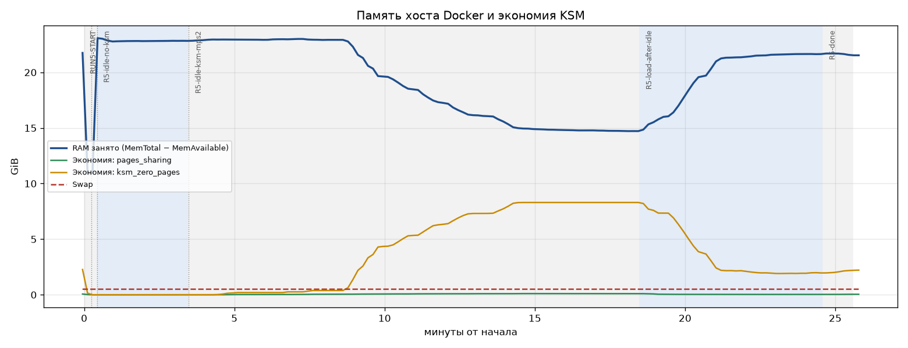
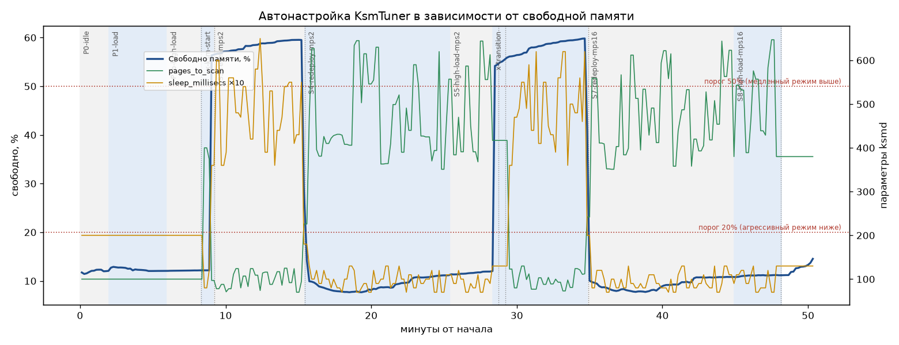
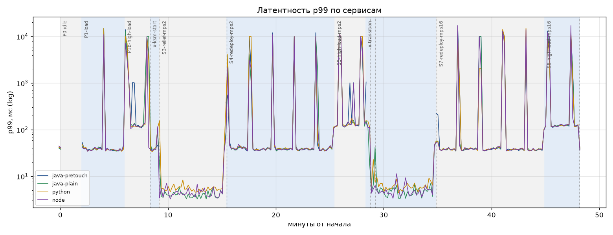

# Эксперимент 3. MemoryGuard на разнородной нагрузке: экономия, автонастройка, безопасность

**Дата:** 2026-10-07, 11:14–14:24 (UTC+3)
**Версия MemoryGuard:** ветка `main` после коммитов `778e921` (слияние + рекомендованный профиль) и `d211808` (исправления по итогам эксперимента)
**Профиль запуска:** рекомендованный, без `--privileged` и `seccomp=unconfined` (см. [docker-compose.yml](../../docker-compose.yml))

---

## 1. Главные выводы

1. **Под реальной нагрузкой MemoryGuard экономит ~1.7–1.8 GiB из 22.3 GiB (≈ 8%).** Без нагрузки та же конфигурация экономит **8.1 GiB (−35% RAM хоста)**. Разница целиком объясняется нулевыми страницами.
2. **97–99% экономии — нулевые страницы** в JVM с `-XX:+AlwaysPreTouch`. Слияние *ненулевых* страниц по всем 26 репликам — **~65 MiB под нагрузкой и ~220 MiB в простое**, хотя каждая реплика строит **побайтно одинаковый** каталог данных. Объекты Java, Python и V8 содержат указатели, заголовки и счётчики, уникальные для каждого процесса. Одинаковые данные не дают одинаковых страниц.
3. **Под нагрузкой экономия на нулевых страницах исчезает за ~2.5 минуты:** 8.2 → 2.2 GiB за 155 с, потому что G1 пишет в весь heap. Прежний результат «adservice −89%» был получен на простаивающей JVM и для нагруженного продакшена не репрезентативен.
4. **`max_page_sharing=2` (защита от CVE-2024-0564) ничего не стоит на этой нагрузке.** Два независимых A/B-замера (2 vs 16) дали одинаковую экономию: 2.07 / 2.06 и 2.01 / 1.96 GiB. На нулевые страницы лимит не действует.
5. **Автонастройка работает:**
   - все три режима ядра включаются по порогам 20% / 50% свободной памяти, в обе стороны, в течение одного тика (12–20 с);
   - тюнер сам переключается, когда экономия KSM освобождает память;
   - защита от OOM отказала в периодическом unmerge 4 раза при нехватке памяти и разрешила его при 59% свободной.
6. **Влияние на сервисы мало:** при нормальной нагрузке p50 +1%, p99 +3% (~+1 мс). CPU ksmd ≈ 0.15 ядра из 18.
7. **Эксперимент нашёл 3 дефекта; все исправлены и подтверждены повторными прогонами:**
   - обход запрета хранилищ данных: Redis сливался;
   - два ложных срабатывания детектора, каждое замораживало ksmd на 10+ минут.

---

## 2. Стенд

| Параметр | Значение |
|---|---|
| Хост | Docker Desktop (WSL2), ядро **6.18.40.1-microsoft-standard-WSL2**, Docker 29.6.1 |
| Ресурсы VM | 18 vCPU, **25.44 GiB RAM**, swap 16 GiB, 1 NUMA-узел |
| Заполнение RAM | **22.3 GiB занято (88%)** до включения KSM, свободно ~12% |

### Нагрузка (30 контейнеров)

Каждый сервис — синтетический микросервис ([workloads/](workloads/)) с одинаковой моделью памяти:
- **общий каталог** строится из фиксированного seed — побайтно одинаковые данные во всех репликах (справочники, каталоги, словари);
- **приватные сессии** заполнены случайными данными — уникальны для реплики;
- **на каждый запрос** чтение окна каталога, мутация сессии и ~50 KB короткоживущего мусора.

| Группа | Реплик | Рантайм / флаги | Каталог | RAM (cgroup) |
|---|---|---|---|---|
| java-pretouch | 8 | Temurin 21, G1, `-Xms1536m -Xmx1536m -XX:+AlwaysPreTouch` | 300 MB | 12.0 GiB |
| java-plain | 6 | Temurin 21, G1, `-Xms512m -Xmx1536m` | 400 MB | 5.7 GiB |
| python | 6 | CPython 3.12, `ThreadingHTTPServer` | 150 MB | 1.36 GiB |
| node | 6 | Node 20, `--max-old-space-size=1536` | 150 MB | 1.24 GiB |
| redis | 2 | Redis 7, `DEBUG POPULATE 400000 key 1000` | — | 0.35 GiB |
| loadgen | 3 | Python, закрытый цикл, `concurrency × 3` | — | 0.17 GiB |
| collector | 1 | метрики каждые 10 с ([collector.py](collector.py)) | — | 0.02 GiB |

**Нагрузка:** нормальная 16×3 = 48 параллельных клиентов, ~2 330 RPS (по ~580 на группу сервисов); высокая 48×3 = 144 клиента, ~2 340 RPS (насыщение: p50 растёт в 3 раза при той же пропускной способности).

### Конфигурация MemoryGuard

```yaml
pid: host
cap_add: [SYS_PTRACE]
volumes: ["/sys/kernel/mm/ksm:/sys/kernel/mm/ksm:rw", "/var/run/docker.sock:/var/run/docker.sock"]
MEMORYGUARD_CONTAINER_WHITELIST: "ksmexp-*"
MEMORYGUARD_EXCLUDE_CONTAINERS: "ksmexp-loadgen-*,ksmexp-collector-*,ksmexp-hog-*,ksmexp-memoryguard-*"
MEMORYGUARD_API_TOKEN: "<token>"
MEMORYGUARD_MAX_PAGE_SHARING: 2 | 16
```

KSM включался **через API дашборда** (`POST /api/ksm/toggle` с токеном), как это сделал бы оператор. Сам агент `run` не трогает (см. §7).

---

## 3. Хронология прогонов

| Прогон | Что проверялось | Итог |
|---|---|---|
| 1 | Полный сценарий | **Остановлен.** Найдены обход запрета Redis и ложное срабатывание детектора («sharing spike»), заморозившее ksmd. Один генератор нагрузки упирался в GIL. |
| 2 | Повтор с исправлением Redis, 3 генератора | **Остановлен.** Второе ложное срабатывание («volatile/sharing ratio = 61997%»). Получены первые данные о реальной экономии под нагрузкой. |
| 3 | Детектор исправлен; фазы «освобождение памяти» и «повторный деплой» | Выполнен, **но параллельно работал «осиротевший» процесс сценария прогона 2** (см. §8). Данные переразмечены по фактической хронологии ([relabel_run3.py](relabel_run3.py)). |
| 4 | Чистый A/B `max_page_sharing` 2 vs 16 | Выполнен, подтверждает прогон 3. |
| 5 | KSM без нагрузки → включение нагрузки | Выполнен. Воспроизводит эффект «−89%» и показывает, как он исчезает. |

Исходные данные каждого прогона лежат в `results/runN/`: `metrics.jsonl`, `latency-*.jsonl`, `phases.log`, логи MemoryGuard, `summary.md`. Графики — в `charts/runN/`.

---

## 4. Экономия памяти

### 4.1. Под нагрузкой (KSM сошёлся, ~10 мин после включения)

| Прогон / фаза | max_page_sharing | Нулевые страницы, GiB | Слитые ненулевые (pages_sharing), GiB | Чистая выгода (general_profit), GiB |
|---|---|---|---|---|
| 3 / S4 redeploy | 2 | 2.07 | 0.03 | 1.81 |
| 3 / S7 redeploy | 16 | 2.06 | 0.06 | 1.82 |
| 4 / R4A | 2 | 2.01 | 0.03 | 1.75 |
| 4 / R4B | 16 | 1.96 | 0.05 | 1.71 |
| 5 / нагрузка после простоя | 2 | 1.96 | 0.03 | 1.70 |

`general_profit` — экономия за вычетом метаданных KSM (rmap_items, ~0.3 GiB на ~22 GiB просканированной памяти).

**Где именно экономия** (прогон 3, S4; `/proc/PID/ksm_stat`, сумма по группе):

| Группа | Нулевые, MiB | Слитые ненулевые, MiB | Доля от RAM группы |
|---|---|---|---|
| java-pretouch ×8 | 2 111 | 54 | 18% |
| java-plain ×6 | 11 | 9 | 0.3% |
| python ×6 | 0.6 | 2.3 | 0.2% |
| node ×6 | 0.4 | 1.6 | 0.2% |
| redis ×2 | — | — | исключён политикой |



### 4.2. Простой против нагрузки (прогон 5)

| Состояние | RAM занято, GiB | Нулевые, GiB | Чистая выгода, GiB |
|---|---|---|---|
| Простой, KSM выключен | 22.83 | — | — |
| Простой, KSM сошёлся (+11 мин) | **14.72** | **8.30** | **8.09 (−35% RAM хоста)** |
| Включена нагрузка, +30 с | 15.78 | 7.34 | 7.09 |
| +90 с | 18.38 | 5.04 | 4.80 |
| +155 с | 21.25 | 2.20 | 1.98 |
| +5 мин (устоялось) | 21.65 | 1.92 | 1.66 |

В простое группа java-pretouch сжалась с 12.0 до **4.6 GiB (−62%)**: 8.1 GiB нулевых страниц. Ровно этот механизм дал «adservice −89%» в прошлом исследовании ([Подробное исследование.md](../Подробное%20исследование.md)): `AlwaysPreTouch` заполняет heap нулями, а незагруженная JVM их не трогает.



### 4.3. Почему одинаковые данные не сливаются

Все реплики строят каталог из одного seed, но KSM сравнивает **страницы по 4 KiB целиком**, а в управляемых рантаймах объекты на странице перемешаны со служебными полями, уникальными для процесса:
* **Java:** mark word (хеш, возраст GC), сжатые указатели на другие объекты. Расположение объектов зависит от TLAB, многопоточной инициализации и перемещения при сборке мусора.
* **Python:** `ob_refcnt` и абсолютные адреса объектов (у каждого процесса свои, ASLR).
* **V8:** указатели на hidden classes и адреса в куче конкретного isolate.

Сливаются только страницы без указателей: нулевые, большие байтовые буферы, а также код и данные из файлов. Последние **уже разделяются** page cache через overlayfs и без KSM.

**Следствие для плана PAMD** ([implementation_plan.md](../../implementation_plan.md)): гипотеза «heap реплик одного образа идентичен на 89%» экспериментом не подтверждается. Реплики одного образа под нагрузкой сливают десятки MiB. Кроме того, дерево KSM общее на хост: пометка только групп реплик не изолирует группы друг от друга (см. [KSM_THREATS.md](../../memoryguard/doc/KSM_THREATS.md) §1).

---

## 5. Автонастройка (KsmTuner)

### 5.1. Режимы и пороги

| Свободно памяти | Режим | База (scan / sleep) | Наблюдалось (с jitter ±30%) | Где |
|---|---|---|---|---|
| < 20% | агрессивный | 500 / 10 мс | 350–650 / 7–13 мс | прогоны 2–5 под нагрузкой (свободно 7–14%) |
| 20–50% | умеренный | 200 / 20 мс | 144–260 / 14–26 мс | прогон 5, простой после слияния (свободно 23–42%) |
| > 50% | медленный | 100 / 50 мс | 74–124 / 36–65 мс | прогон 3, java-pretouch остановлены (свободно 57–59%) |



* **Переключение в обе стороны:**
  - остановка 8 JVM (свободно 12% → 57%) переводит в медленный режим;
  - их перезапуск (→ 9%) возвращает агрессивный;
  - в обоих случаях — в течение одного тика.
* **Самопереключение:** в прогоне 5 экономия KSM подняла свободную память с 10% до 33%. Тюнер сам ушёл из агрессивного режима в умеренный, а при возврате нагрузки (+155 с) вернулся в агрессивный.
* **Скорость сходимости:** KSM сливает страницу только при втором стабильном проходе. В агрессивном режиме полный проход по ~22 GiB занимает 3–4 минуты. Заметная экономия появляется через 5–8 минут после включения и выходит на плато к 9–11 минуте.
* **Медленный режим почти не сканирует:** при 59% свободной памяти полный проход занял бы ~20 минут. Это сознательная экономия CPU, когда память не нужна.

### 5.2. Периодический unmerge и защита от OOM

| Время | Свободно | Решение |
|---|---|---|
| 12:32:02 (прогон 2) | 12.0% | пропущен: «needs 1249 MB … OOM risk» |
| 12:54:20 (прогон 3) | 59% | **выполнен** |
| 13:22:06 (прогон 3) | 9.7% | пропущен: «needs 1858 MB» |
| 13:53:13 (прогон 4) | 13.5% | пропущен: «needs 2048 MB» |
| 14:10:31 (прогон 5) | 34.7% | пропущен: «needs 7254 MB» (8.8 GiB свободно) |

Без проверки запаса unmerge в 14:10:31 вернул бы 7.3 GiB при 8.8 GiB свободной памяти: у хоста осталось бы 1.5 GiB (6%). Защита работает как задумано. Но на хосте, где KSM нужен (память занята), периодический unmerge **почти никогда не выполняется**, и как мера защиты он в таком режиме не действует.

### 5.3. Детектор аномалий

| Прогон | Время | Правило | Причина | Последствие |
|---|---|---|---|---|
| 1 | 11:50:40 | рост `pages_sharing` в 25× EMA | первая волна слияний после 2 проходов — **нормальная сходимость** | ksmd заморожен на 10+ мин, экономия остановилась на 1.55 GiB |
| 2 | 12:33:50 | `pages_volatile / pages_sharing` = 61 997% | при `use_zero_pages` экономия идёт в `ksm_zero_pages`, а volatile на heap с GC — миллионы | ksmd заморожен |
| 5 | 14:17:14 | падение `pages_sharing` на 41% за тик | возврат нагрузки после простоя: GC пишет в слитые страницы | только запись в лог (после исправления) |

Исправлено (коммит `d211808`):
* правила 1 и 2 удалены как некорректные по построению;
* прогрев теперь считается по сходимости KSM (3 полных прохода), а не по 5 тикам;
* реакция по умолчанию — только лог (`MEMORYGUARD_ANOMALY_ACTION=log`), unmerge/заморозка включаются явно (`respond`).

Третье срабатывание подтверждает, что так и нужно: глобальные счётчики ядра не отличают атаку от смены режима нагрузки.

---

## 6. Влияние на сервисы

### 6.1. Латентность

Медиана по 10-секундным окнам всех генераторов. Худшие окна 3–20 с (`p99 худшего окна` в `summary.md`) — это ретрансмиты TCP SYN (ступени 1/3/7/15 с) из-за малого backlog тестовых серверов. Они есть и **без** KSM.

| Нагрузка | Без KSM | С KSM (mps=2) | С KSM (mps=16) | Разница |
|---|---|---|---|---|
| Нормальная (48 клиентов) p50, мс | 16.7–17.0 | 16.8–17.2 | 16.9–17.3 | +1% |
| Нормальная p99, мс | 35.9–36.4 | 37.0–37.9 | 36.8–37.3 | +3% (~1 мс) |
| Высокая (144 клиента) p50, мс | 45.8–50.5¹ | 50.5–51.1 | 50.7–51.1 | на верхней границе разброса базовой линии (+0–10%) |
| Высокая p99, мс | 112.9–117.1¹ | 120.7–125.3 | 119.8–121.1 | +4–8% |

¹ Разброс базовой линии между прогонами 2 и 3.

Ошибок нет, кроме фаз, где JVM намеренно останавливались.



### 6.2. CPU

ksmd на Docker Desktop не виден из `pid: host` (это пространство имён VM, а не ядра). Поэтому оценка сделана по системному времени `/proc/stat`:
* **простой:** 1.35% → 2.15% всех CPU, то есть **≈ 0.15 ядра из 18** на работу ksmd в агрессивном/умеренном режиме;
* **под нагрузкой:** 22.25% → 22.2–22.8%, в пределах шума.

Сам агент MemoryGuard занимает ~50 MiB RAM.

---

## 7. Проверка безопасности и профиля запуска

| Проверка | Результат |
|---|---|
| Запуск **без `--privileged`** (`pid: host`, `SYS_PTRACE`, bind-mount только `/sys/kernel/mm/ksm`) | ✅ Работает на ядре 6.18. Hardening применён и перечитан, в том числе после unmerge. |
| Политика доверия | ✅ 26 процессов инжектированы, `loadgen`/`collector`/`memoryguard` исключены по `MEMORYGUARD_EXCLUDE_CONTAINERS`. |
| Запрет хранилищ данных | ❌→✅ **Прогон 1: Redis слит.** После `docker pull` тег переехал, и Docker отдал в поле `Image` голый `sha256:…`. Исправлено: проверяются `Config.Image` и имя процесса (`redis-server`, `memcached`, `mysqld`, `postgres`, …). В прогонах 2–5 Redis отклонён. |
| Фильтр секретной памяти | ✅ В каждой JVM пропущены 22–25 стеков потоков (~40 MiB), в Python — `.bss` `libcrypto` и регион с `MADV_DONTDUMP`/mlock. |
| Автоинжекция новых реплик | ✅ После перезапуска 8 JVM (новые PID) все инжектированы в течение 35 с. |
| API | ✅ Включение KSM только с токеном. |
| KSM включается агентом | ⚠️ **Нет** (в этих прогонах). ✅ Реализовано позже: `MEMORYGUARD_KSM_AUTOSTART`, см. [часть 2](Отчёт_2_адаптивный_тюнер.md). |
| Регионы, созданные после инжекции | ⚠️ Инжекция однократная на процесс (в этих прогонах). ✅ Реализовано позже: повторная инжекция `MEMORYGUARD_REINJECT_MINUTES` дотягивает 2–4 GiB новых регионов за 30 мин, см. [часть 2](Отчёт_2_адаптивный_тюнер.md). Альтернатива без ptrace — `prctl(PR_SET_MEMORY_MERGE)` (ядро ≥ 6.4) в entrypoint. |

---

## 8. Ограничения и проблемы методики

* **Docker Desktop, а не bare metal:** один NUMA-узел (`merge_across_nodes` не проверен), ksmd не виден напрямую.
* **«Осиротевший» сценарий (прогоны 2–3).** Остановка фоновой задачи убила обёртку, но не `bash run_phases.sh`. Bash читает скрипт с диска по смещению и продолжил выполнять **переписанный** файл. Он:
  - остановил JVM на 53-й секунде фазы P2 прогона 3;
  - перезапустил MemoryGuard с `max_page_sharing=16`;
  - переписал метки фаз.

  Хронология восстановлена по журналу и логам MemoryGuard ([relabel_run3.py](relabel_run3.py), исходный журнал — `results/run3/phases_raw.log`). Выводы прогона 3 подтверждены чистыми прогонами 4–5.
* **Swap.** Между прогонами 1 и 2 в swap ушло 1.8 GiB, далее держалось 0.5 GiB. Вероятная причина: сирота прогона 1 запустил `hog` на 3.5 GB около 12:00. Метрики этого окна удалены при старте прогона 2, так что причина не доказана. Страницы в swap KSM не сканирует.
* **Генератор нагрузки** — закрытый цикл на Python. В прогоне 1 он упирался в GIL (p99 в секундах), с прогона 2 используются 3 генератора. Абсолютная латентность включает накладные расходы генератора, но сравнение фаз корректно.
* **Синтетические сервисы.** Модель памяти «каталог + сессии + мусор» типична, но реальные приложения с большими байтовыми буферами (кеши изображений, сжатые блобы, ML-веса в `bytearray`) могут сливаться лучше.
* **Не проверено:** реакция `MEMORYGUARD_ANOMALY_ACTION=respond` на настоящую атаку; работа на ядрах < 6.x; `merge_across_nodes` на NUMA.

---

## 9. Рекомендации

1. **Позиционирование.** Честная оценка для статьи и продукта:
   - **до −35% RAM на хостах с простаивающими JVM, у которых `AlwaysPreTouch`;**
   - **~8% под постоянной нагрузкой;**
   - почти 0 для Python/Node.

   Основной источник экономии — нулевые страницы, а не «одинаковые данные реплик».
2. **Целевые сценарии:** staging и dev-кластеры, пулы простаивающих реплик, scale-to-zero-подобные нагрузки, JVM с завышенным `-Xms`. Под постоянную нагрузку выгоды мало.
3. **Оставить `max_page_sharing=2` по умолчанию:** на реальной нагрузке он бесплатен.
4. **Детектор аномалий** — только как источник логов/метрик. Для атрибуции использовать `/proc/PID/ksm_stat` по контейнерам.
5. **Адаптивный тюнер, автозапуск и повторная инжекция — реализованы**, см. [часть 2](Отчёт_2_адаптивный_тюнер.md): +23% экономии за цикл при −22% работы ksmd.
6. **Следующие доработки** (в порядке пользы):
   - приближение к режиму «только нулевые страницы». В ядре такого режима нет. Можно помечать лишь регионы, где по выборке через `process_vm_readv` преобладают нули. Это сохраняет основную экономию и сужает поверхность атаки, но ненулевые страницы в таких регионах всё равно будут сливаться;
   - `PR_SET_MEMORY_MERGE` вместо ptrace там, где можно менять entrypoint.

---

## 10. Воспроизведение

```bash
cd Исследования/Эксперимент_3_нагрузка
javac --release 21 -d workloads/classes workloads/CatalogService.java
docker build -t memoryguard:latest ../../memoryguard
docker compose -p ksmexp -f docker-compose.experiment.yml up -d   # ~10 мин на прогрев Python
bash run_phases.sh        # основной сценарий; run_ab.sh — A/B; run_idle.sh — простой
docker run --rm -v "$PWD:/e" -w /e python:3.12-slim sh -c "pip install matplotlib && python analyze.py"
```

> ⚠️ Не редактируйте `run_*.sh` во время выполнения и проверяйте после остановки, что процессов `bash run_*.sh` не осталось (§8).
